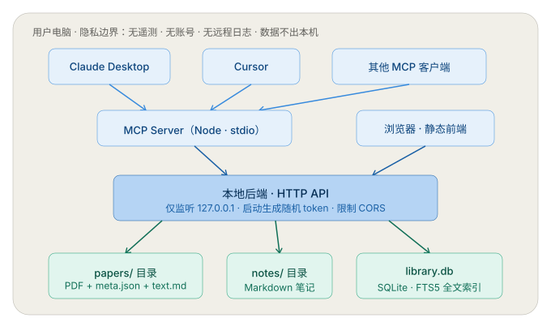
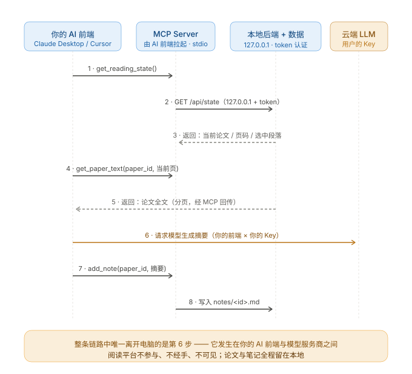
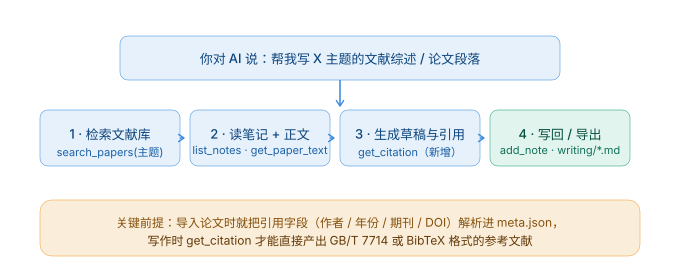

# PaperVerse

本地优先的文献阅读工作台。论文、笔记、阅读进度全部保存在你自己的电脑上；AI 能力由你自己电脑上的 AI 前端（Claude Desktop / Cursor 等）通过 MCP 接入——密钥归你管，本软件不接触、不存储任何 API Key。

## 当前版本：v0.1.0

这是空库发行版，不包含开发者收集的文献、PDF、个人笔记或本机访问令牌。首次运行后由使用者添加自己的资料。软件通过本机 Python 服务运行，不能仅将静态页面部署到托管平台就获得完整读写功能。

- 原有阅读、搜索、笔记与 MCP 功能保留；MCP 全文读取分页，笔记写入受 revision 冲突保护。
- 71个界面图标已替换为 Lucide 1.61.0，原文件名和组件调用方式保持不变。
- 已完成隔离空库构建与1440/390宽度图标回归，未使用真实文献库进行写入测试。
- 当前仓库为独立无旧历史的交付副本；模板派生代码的授权待核实项及GSAP版本依据限制见第三方声明。

## 特性

- **本地 PDF 阅读**：内置 PDF 引擎，支持全文阅读、批注与笔记
- **添加文献**：录入标题、作者、期刊、年份、DOI，并关联 PDF；DOI 自动规范化，重复导入自动拦截
- **全文检索**：覆盖文献记录、PDF 文字层、笔记与研究问题，支持中文短词（两字词）检索
- **AI 就绪**：内置 MCP Server，你的 AI 前端可直接读取文献、分页读取全文、检索、取当前阅读状态、写笔记
- **数据无锁定**：论文是 PDF，笔记是 Markdown，元数据是 JSON，索引是 SQLite —— 即使本软件停止维护，你的数据依然可读可迁移
- **数据安全内置**：原子写入防文件损坏、笔记保留历史版本、笔记删除先进回收区

## 隐私承诺

- 无账号系统，无需注册
- 无遥测、无统计、无崩溃上报
- 无远程日志
- 本软件不主动上传论文和笔记；接入云端 AI 客户端后，客户端可能向模型服务发送读取的内容
- 不内置、不接触、不存储任何 AI API Key
- 本地服务仅监听 `127.0.0.1`，首次启动生成随机访问令牌

详见 [PRIVACY.md](PRIVACY.md)。仓库附源码可自行审计；自有代码与第三方组件的许可范围不同，第三方再分发依据及尚存限制见许可声明。

## 工作原理与数据流

PaperVerse 不内置任何 AI 模型，也不接触 API Key。它通过内置的 MCP Server，把文献库开放给你自己电脑上的 AI 前端：



- 本地后端仅监听 `127.0.0.1`，首次启动生成 MCP 认证 token，写入数据目录的 `config.json`；这不表示所有网页接口均使用该 token
- MCP Server 由 AI 前端通过 stdio 自动拉起，自行读取 token——用户无需手工配置认证
- 数据落盘为标准格式（PDF / Markdown / JSON / SQLite），无私有格式锁定
- MCP 暴露的能力以「读」为主，「写」仅限笔记；不提供修改论文、任意路径读写等工具

配置 AI 客户端后的示例调用流程：



接入云端模型时，**AI 客户端可能把通过 MCP 读取的文献和笔记发送给模型服务商**；请按客户端的数据政策决定读取范围。PaperVerse 不管理模型服务凭据。首次安装依赖以及用户主动打开 DOI、论文官网等出处链接，也需要网络。

## 快速开始（当前候选版）

本阶段为**需要系统 Python 的候选版**，免安装运行时的打包在路线图中。

1. 安装 Python 3.12（本阶段锁定依赖以 3.12 实测；其他版本兼容性未全部验证）
2. 在软件目录打开 PowerShell，创建虚拟环境并安装锁定依赖（仅首次，需联网一次）：

```powershell
python -m venv .venv
.\.venv\Scripts\python.exe -X utf8 -m pip install -r .\运行依赖锁定.txt
.\.venv\Scripts\python.exe -X utf8 -m pip check
```

3. 双击 `start.bat`，浏览器自动打开

服务只监听本机，重复双击会复用已有窗口，不会重复启动。

## 添加第一篇文献

1. 点击「添加文献」；标题必填，作者、期刊、年份、DOI 未知可留空
2. 可选关联 PDF，确认后建立标准目录并提取文字层；PDF 失败时会明确提示元数据已入库，允许重试
3. 相同规范化 DOI 打开已有记录，不重复创建或覆盖；无 DOI 时按题目、作者、年份组合判重

没有自动抓取远程元数据，不进行 OCR。扫描版 PDF 可正常阅读，但无文字层时不参与全文检索。

## 接入你的 AI（MCP）

本平台内置 MCP Server，共 11 个工具。完整配置见 [MCP_SETUP.md](MCP_SETUP.md)。

Claude Desktop 配置示例（`claude_desktop_config.json`）：

```json
{
  "mcpServers": {
    "paperverse": {
      "command": "<软件目录>/.venv/Scripts/python.exe",
      "args": ["-I", "-B", "-X", "utf8", "<软件目录>/MCP服务.py", "--data-dir", "<软件目录>"]
    }
  }
}
```

可用能力（读为主，写仅限笔记）：

| 工具 | 说明 |
|------|------|
| `list_papers` / `get_paper` | 文献列表与元数据（分页） |
| `get_paper_text` | 必须指定 offset，默认 2,000 / 上限 4,000 字符，返回 next_offset |
| `search_papers` | 文献记录、PDF 文字层与笔记检索 |
| `get_reading_state` | 当前笔记与全库 revision |
| `list_notes` / `add_note` / `update_note` / `delete_note` | 笔记读写（写入需 revision，冲突不覆盖） |
| `get_citation` / `export_bibtex` | 引用字段与 BibTeX（缺失字段不补造） |

## 用 AI 辅助写作（反用文献库）

阅读是正向用法，写作是反向用法——同一座 MCP 桥，AI 从你的文献库里取料：



典型对话：

- 「搜我库里所有关于 X 的文献和笔记，按观点分组，给我一个综述大纲」
- 「把这段综述的引用整理成 GB/T 7714 格式」
- 「把刚才生成的这段存为这篇文献的笔记」

几个设计要点：

- **你的笔记是最优质的写作素材**：AI 先读笔记再按需回查原文，产出会带上你自己的理解和判断
- **引用字段可导出**：导出已录入字段与中性 misc BibTeX；缺失信息不补造。AI生成的GB/T等引用格式仍需核对，不是平台已实现的自动格式转换
- **平台不内置写作器**：草稿写在你的 AI 前端工作区，PaperVerse 专注做最好的供料层

## 数据存在哪

数据保存在本实例的软件目录；尚无首次启动选择目录的界面：

```
papers/<id>/paper.pdf + meta.json + text.md   论文原文、元数据、文字层
notes/<id>.md                                  笔记（Markdown）
notes/.history/                                笔记历史版本
.trash/                                        笔记回收区
资料目录.json / 标准存储启用.json              目录索引与启用标记（迁移必需）
library.db                                     检索索引（可重建）
config.json                                    本机状态：端口 + 随机令牌
.运行状态/服务日志.txt                         本机服务日志（分享前检查异常诊断）
```

## 备份与迁移

- **笔记备份**：设置区「导出全部笔记备份」得到 JSON 文件；「导入旧笔记 / 恢复备份」可预览后合并，已有笔记保留、不同内容合并
- **文献记录导出**：可导出有个人记录的文献为 CSV
- **完整备份 / 换电脑**：先关闭本实例服务。必须保留 `papers/`、`notes/`（含索引和历史）、`资料目录.json`、`标准存储启用.json`；如需完整历史，同时保留 `.trash/`、`.事务/` 等记录。`config.json` 应显式排除，目标实例生成新令牌；`library.db` 可重建。缺少目录索引或启用标记时不能声称自动恢复，先核对完整备份。不要覆盖运行中的目标目录。
- 旧版网页中的笔记保存在浏览器，请先在旧页面导出，再在本软件中预览导入

## 已知限制

- **暂无整篇文献的删除界面**：目前可删除笔记（进入回收区），文献条目的删除功能在路线图中
- **扫描版 PDF 不参与检索**：无文字层时仅可阅读，不做 OCR
- **同一 PDF 不同元数据的情况未做全库去重**：去重依据为 DOI / 元数据组合
- **当前需系统 Python**：免安装运行时（内嵌 Python）在路线图中
- **无自动更新**、**无多设备实时同步**、**无账号系统**：均为本地优先的设计取舍
- Windows 首次运行可能触发 SmartScreen 提示（未购买代码签名证书）

## 路线图

- 文献条目删除、标签与收藏管理
- 免安装运行时打包（内嵌 Python）、macOS 分发
- OCR（扫描版检索）、更多引用格式
- 桌面应用打包（Tauri）

## 技术安装说明与校订记录

原候选版技术说明完整保存在 [INSTALL.md](INSTALL.md)，未删减。该文件按原样归档，其中旧的发行状态（例如隐私文件尚未入包）以本 README、PRIVACY.md 和 [文档修改记录](文档修改记录.md) 为准。

## 许可

自有代码采用 [MIT](LICENSE)。随包第三方组件（PDF.js、字体、GSAP、Lucide 等）各有独立许可，详见 [THIRD_PARTY_NOTICES.md](THIRD_PARTY_NOTICES.md)。
